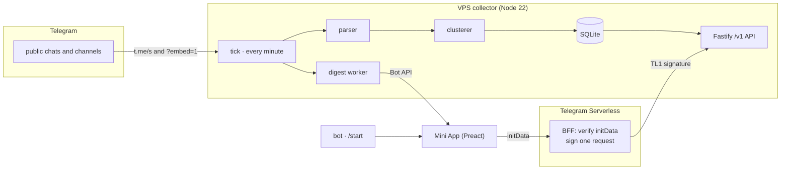

<picture>
  <source media="(prefers-color-scheme: dark)" srcset="assets/banner-dark.svg">
  <source media="(prefers-color-scheme: light)" srcset="assets/banner-light.svg">
  
</picture>

# Теле-Лента

**One feed for the classifieds, jobs, and events scattered across public
Montenegrin and Serbian Telegram chats.** Every card keeps a link back to the
chat and the message it came from; the conversation happens there, not here.

[](https://github.com/ValDagon/tele-lenta/actions/workflows/ci.yml)
[](LICENSE)
[](https://nodejs.org)
[](https://preactjs.com)
[](CONTRIBUTING.md)

**Language:** English · [简体中文](README.zh.md)

> [!IMPORTANT]
> This repository is a complete, self-hosted blueprint — not a hosted service.
> Running it needs your own Telegram bot token, your own [Telegram
> Serverless](https://tgcloud.ai) project for the Mini App and the BFF, and a
> small VPS (or any always-on host) for the collector. Nothing here points at a
> server you do not control.

> [!WARNING]
> The collector reads **public** Telegram embed pages. That is subject to
> Telegram's terms of service and to the rules of each source chat, and the
> operator — not the maintainer of this code — carries that risk. The project
> deliberately uses no user account and no userbot: there is no account to ban.
> If you fork it, keep it polite (it ships with a per-source request budget, a
> descriptive `User-Agent`, and a negative cache) and honour a removal request
> from any chat admin.

## What it does

The feed is the product. A card is not one message: cross-posting is the norm in
regional classifieds, so identical offers from several chats collapse into one
**cluster** with a source trail, and you see the offer once.

- **Three sections** — Объявления, Вакансии, Мероприятия — one chronological
  feed, no marketplace grid.
- **Clusters** — the same offer across several chats becomes one card showing
  every source and the earliest publication time.
- **Search, filters, saved searches** — filters compose (region, category,
  price, Куплю/Ищу), and a saved search can be delivered as a **digest**.
- **Digests with quiet hours** — the collector batches new matches and sends
  them through the Bot API inside a window you choose.
- **Real Telegram chrome** — `initData` verification, theme parameters, the
  back button, haptics, safe areas, and a data-driven contrast guardrail.
- **Owner controls** — a private allowlist gate, an admin CLI, and an alert to
  the owner when a source degrades or the feed goes stale.



## Quick start

Node **22+** and npm 10+. No database server, no Python, nothing to provision for
the test suite.

```bash
git clone https://github.com/ValDagon/tele-lenta.git
cd tele-lenta
npm ci
```

Run the full verification suite — the same three commands CI runs:

```bash
npm run typecheck   # Preact app + VPS workspace
npm test            # 247 Mini App tests (Vitest) + 494 collector tests
npm run test:tgcloud # 142 Serverless BFF tests
```

Start the Mini App against a local API:

```bash
cp .env.example .env      # fill TL_SHARED_SECRET, TL_BOT_TOKEN, ...
npm -w vps run migrate    # create the SQLite schema
npm run dev               # Vite dev server for the Mini App
```

The Mini App only runs inside Telegram: without `initData` it shows the access
gate. To see real data locally, backfill one source first
(`npm -w vps run backfill -- @montework`) and open the app from a bot that owns
the deployment.

<details>
<summary><b>The three runtimes, and why there are three</b></summary>

Telegram Serverless has no cron and no long-running process, so it cannot poll
anything, while the collector must poll every minute. The split follows from
that (ADR-0003):

| Runtime | Path | Job |
| --- | --- | --- |
| Mini App | `src/` | The reading surface. Preact, TypeScript, Tailwind v4, pure model modules with tests beside them. |
| Serverless BFF | `tgcloud/` | Verifies Telegram `initData`, extracts the user, signs one request to the VPS, returns its JSON untouched. Plain ESM, no npm at runtime, no product storage. |
| Collector | `vps/` | Fastify API, SQLite store, parser, clusterer, digest worker, retention. Node 22 and TypeScript, hand-written SQL migrations, no ORM. |

The BFF keeps no second copy of the bot token: it re-derives the `initData`
hash itself, so the check is visible and testable instead of trusting an
undocumented platform guarantee (ADR-0005).
</details>

<details>
<summary><b>Ingestion, honestly</b></summary>

There is no bulk endpoint, no bot in the source chat, and no account. A channel
is read from `https://t.me/s/<channel>` (20 messages per page); a group message
from `https://t.me/<group>/<id>?embed=1` (one request per id, so a per-source
cursor and an adaptive id window do the work). Albums repeat one caption across
several ids and are collapsed by text, first photo, and timestamp.

Three consequences a fork must accept:

1. **HTML drift is the main failure mode.** A parser fixture test is mandatory;
   a silent parser break stops the feed. The collector records parse errors and
   pages the owner instead of showing an empty feed.
2. **Politeness is a feature.** Per-source request budgets, one request per
   second per source, a descriptive `User-Agent`, and a 24-hour negative cache
   for "Post not found".
3. **An explicit not-found is data.** It marks a listing deleted instead of
   guessing, which is why the retention pass can trust the store.
</details>

<details>
<summary><b>Why the feed unit is a cluster</b></summary>

The same offer is posted to five chats with the same text and photos. One card
per message would fill the feed with duplicates and make every digest repeat
itself. Listings stay individual rows; a cluster groups them by normalized text,
price, and city within a short window, with a specificity guard that keeps short
generic lines as singletons (ADR-0001). The first photo corroborates a merge but
is not required, because a cross-post may re-upload it.
</details>

<details>
<summary><b>Repository layout</b></summary>

```
src/              Mini App: views, components, pure model modules + tests
tgcloud/          bot handler and BFF (endpoints/, lib/, test/)
vps/              collector: api/, store/, ingest/, parser/, tick/, digest/
vps/migrations/   numbered SQL, applied in filename order
vps/test/fixtures/ sanitized real Telegram HTML
docs/adr/         decisions that are expensive to reverse
docs/design/      the UI direction and screen-level notes
docs/research/    cited research that fed the decisions
GLOSSARY.md       the domain vocabulary (Russian terms, English glosses)
AGENTS.md         the working agreement for coding agents
```

Configuration lives in `.env` (see `.env.example`); every variable and its
default is documented in [`vps/README.md`](vps/README.md#configuration).
</details>

<details>
<summary><b>Deployment order</b></summary>

1. `npm -w vps run migrate` on the VPS, then start `npm -w vps run build` output
   under a service manager. The API never migrates on boot.
2. Terminate TLS at Caddy (`vps/deploy/Caddyfile`): only `/v1/*` and `/health`
   are public, the API listens on loopback.
3. `npx tgcloud push` for the Serverless BFF and the static Mini App build.
4. Set `TL_BOT_USERNAME` and the Mini App URL so `/start` answers with the app
   button; the digest and deep links need both.

Put the collector tick on system cron, every minute. Do not run two ticks at
once: the tick takes a lock and reports the collision instead of doubling work.
</details>

## Status

The v1 implementation is complete and covered by tests (883 across the three
runtimes). A public pilot is not running: the open issue is the pilot and the
final design pass. Expect rough edges in deployments you configure yourself, and
open an issue when you hit one.

## Contributing

Read [CONTRIBUTING.md](CONTRIBUTING.md) first — it lists the commands, the
conventions, and what a pull request must contain. Security issues go through
[private reporting](SECURITY.md), never a public issue.

## License

[Apache-2.0](LICENSE) © 2026 Valentin Kazantsev. Bundled assets and their
licenses are listed in [NOTICE](NOTICE).

> [!NOTE]
> The product copy and the domain vocabulary are in Russian, because the first
> audience is Russian-speaking Montenegro and Serbia. Code, tests, and
> documentation are in English so the project can be handed to anyone.
