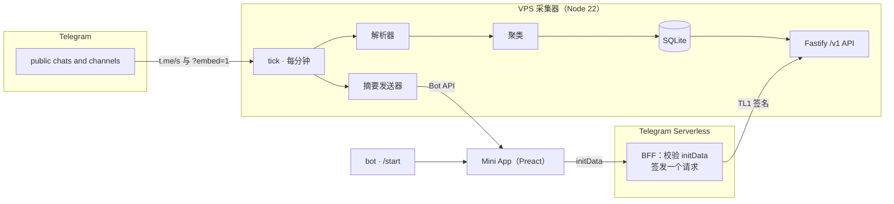

<picture>
  <source media="(prefers-color-scheme: dark)" srcset="assets/banner-dark.svg">
  <source media="(prefers-color-scheme: light)" srcset="assets/banner-light.svg">
  
</picture>

# Теле-Лента

**把黑山与塞尔维亚众多公开 Telegram 群里的二手信息、招聘和活动，汇总成一条信息流。**
每张卡片都保留回到原群、原消息的链接；沟通发生在原群里，不在这里。

[](https://github.com/ValDagon/tele-lenta/actions/workflows/ci.yml)
[](LICENSE)
[](https://nodejs.org)
[](https://preactjs.com)
[](CONTRIBUTING.md)

**语言：** [English](README.md) · 简体中文

> [!IMPORTANT]
> 本仓库是一套**自托管的完整蓝图**，而不是一个在线服务。运行它需要你自己的
> Telegram 机器人 token、你自己的 [Telegram Serverless](https://tgcloud.ai)
> 项目（用于 Mini App 和 BFF），以及一台用于采集器的小型 VPS（或任何常开主机）。
> 仓库里没有任何东西指向你不控制的服务器。

> [!WARNING]
> 采集器读取的是**公开**的 Telegram 嵌入页面。这受 Telegram 服务条款以及每个来源群
> 规则的约束，风险由部署者（而不是代码作者）承担。项目刻意不使用任何用户账号或
> userbot：没有可被封的账号。如果你要 fork，请保持克制（项目自带每来源请求预算、
> 明确的 `User-Agent` 和 24 小时负缓存），并尊重任何群管理员的下架要求。

## 它做什么

信息流本身就是产品。一张卡片不是一条消息：地区二手市场里重复发布是常态，因此来自
多个群的同一offer会被合并成一个**簇（cluster）**，带上来源链，你只看到一次。

- **三个分区** —— 二手（Объявления）、招聘（Вакансии）、活动（Мероприятия），
  一条按时间排序的信息流，没有电商网格。
- **簇** —— 同一 offer 在多个群出现时合并为一张卡片，显示全部来源和最早发布时间。
- **搜索、筛选、保存的搜索** —— 筛选条件可叠加（地区、分类、价格、求购），
  保存的搜索可以按**摘要（digest）**投递。
- **带免打扰时段的摘要** —— 采集器把新匹配批量汇总，在你选择的时间窗内通过 Bot API 发送。
- **真实的 Telegram 质感** —— `initData` 校验、主题参数、返回键、触感反馈、安全区域，
  以及由数据驱动的对比度护栏。
- **运营者控制** —— 私有白名单门槛、管理 CLI，以及来源退化或信息流过期时给运营者的告警。



## 快速开始

需要 Node **22+** 和 npm 10+。跑测试不需要数据库服务、不需要 Python、不需要任何外部资源。

```bash
git clone https://github.com/ValDagon/tele-lenta.git
cd tele-lenta
npm ci
```

运行完整校验套件 —— 与 CI 完全相同的三条命令：

```bash
npm run typecheck   # Preact 应用 + VPS 工作区
npm test            # 247 个 Mini App 测试（Vitest）+ 494 个采集器测试
npm run test:tgcloud # 142 个 Serverless BFF 测试
```

在本地启动 Mini App：

```bash
cp .env.example .env      # 填写 TL_SHARED_SECRET、TL_BOT_TOKEN 等
npm -w vps run migrate    # 创建 SQLite 结构
npm run dev               # Mini App 的 Vite 开发服务器
```

Mini App 只能在 Telegram 内运行：没有 `initData` 时它显示访问门槛。想看真实数据，
先回填一个来源（`npm -w vps run backfill -- @montework`），再从拥有该部署的机器人打开应用。

<details>
<summary><b>三个运行时，以及为什么是三个</b></summary>

Telegram Serverless 没有 cron，也没有长驻进程，因此它无法轮询；而采集器必须每分钟轮询。
拆分由此而来（ADR-0003）：

| 运行时 | 路径 | 职责 |
| --- | --- | --- |
| Mini App | `src/` | 阅读界面。Preact、TypeScript、Tailwind v4，纯模型模块与其测试并列。 |
| Serverless BFF | `tgcloud/` | 校验 Telegram `initData`，取出用户，向 VPS 签发一个请求，原样返回其 JSON。运行时零 npm 依赖，不保存产品数据。 |
| 采集器 | `vps/` | Fastify API、SQLite 存储、解析器、聚类、摘要发送、保留策略。Node 22 + TypeScript，手写编号 SQL 迁移，不使用 ORM。 |

BFF 不保存 bot token 的第二份副本：它自己重新推导 `initData` 哈希，
因此这项校验是可见、可测试的，而不是依赖某个未文档化的平台保证（ADR-0005）。
</details>

<details>
<summary><b>关于采集，说实话</b></summary>

没有批量接口，不往来源群里加机器人，不使用账号。频道从
`https://t.me/s/<channel>` 读取（每页 20 条消息）；群消息从
`https://t.me/<group>/<id>?embed=1` 读取（每个 id 一次请求，因此需要每来源游标和
自适应 id 窗口）。相册会在多个 id 上重复同一段标题，按文本、首图和时间戳合并。

Fork 的人必须接受三个后果：

1. **HTML 漂移是主要故障模式。** 解析器的 fixture 测试是强制的；解析器静默损坏会停掉
   信息流。采集器会记录解析错误并通知运营者，而不是显示一条空信息流。
2. **克制是功能，不是礼貌。** 每来源请求预算、每来源每秒一次请求、明确的
   `User-Agent`，以及 24 小时「Post not found」负缓存。
3. **显式 not-found 也是数据。** 它把条目标记为已删除，而不是靠猜，因此保留策略可以信任存储。
</details>

<details>
<summary><b>为什么信息流单位是簇</b></summary>

同一个 offer 会被发到五个群，文本和图片都一样。每条消息一张卡片会让信息流塞满重复项，
并让每份摘要自我重复。条目仍然是独立行；簇在短时间窗内按归一化文本、价格和城市分组，
并用特异性护栏把过于笼统的短句保留为单条（ADR-0001）。首图用于佐证合并，
但不是必需条件，因为转发时图片可能被重新上传。
</details>

<details>
<summary><b>仓库结构</b></summary>

```
src/              Mini App：视图、组件、纯模型模块与其测试
tgcloud/          机器人 handler 与 BFF（endpoints/、lib/、test/）
vps/              采集器：api/、store/、ingest/、parser/、tick/、digest/
vps/migrations/   编号 SQL，按文件名顺序执行
vps/test/fixtures/ 脱敏的真实 Telegram HTML
docs/adr/         值得慎重对待、难以回退的决策
docs/design/      UI 方向与逐屏设计说明
docs/research/    带引用的调研笔记
GLOSSARY.md       领域词汇（俄语术语 + 英语释义）
AGENTS.md         面向编码代理的协作约定
```

配置放在 `.env`（见 `.env.example`）；每个变量及其默认值记录在
[`vps/README.md`](vps/README.md#configuration)。
</details>

<details>
<summary><b>部署顺序</b></summary>

1. 在 VPS 上执行 `npm -w vps run migrate`，然后在服务管理器下运行
   `npm -w vps run build` 的产物。API 启动时从不自动迁移。
2. 在 Caddy 终止 TLS（`vps/deploy/Caddyfile`）：只有 `/v1/*` 和 `/health` 对外，
   API 本身只监听回环地址。
3. `npx tgcloud push` 部署 Serverless BFF 和静态 Mini App 构建。
4. 设置 `TL_BOT_USERNAME` 与 Mini App URL，让 `/start` 回复应用按钮；
   摘要与深链都需要这两项。

把采集 tick 放进系统 cron，每分钟一次。不要同时跑两个 tick：
tick 会加锁并报告冲突，而不是把工作量翻倍。
</details>

## 状态

v1 实现已完成，并被测试覆盖（三个运行时共 883 个测试）。尚未有公开试运行：
未关闭的 issue 是试点与最终设计打磨。你自己配置的部署可能会遇到粗糙边缘，
遇到问题请开 issue。

## 参与贡献

先读 [CONTRIBUTING.md](CONTRIBUTING.md) —— 里面列出命令、约定，以及一个 pull request
必须包含什么。安全问题请走[私密报告](SECURITY.md)，永远不要开公开 issue。

## 许可证

[Apache-2.0](LICENSE) © 2026 Valentin Kazantsev。内置资源及其许可证见 [NOTICE](NOTICE)。

> [!NOTE]
> 产品文案与领域词汇使用俄语，因为第一受众是讲俄语的黑山与塞尔维亚用户。
> 代码、测试和文档使用英语，以便把项目交给任何人。
